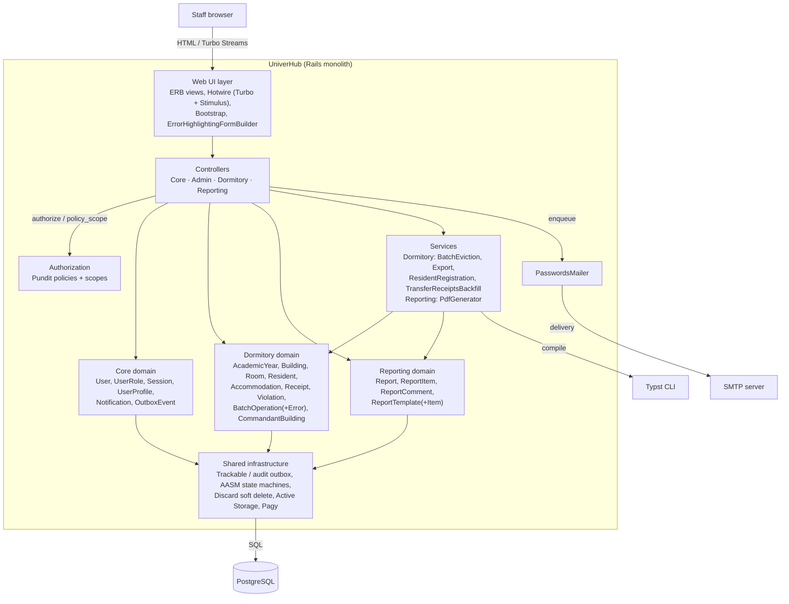

# C4 — Level 2: Components

Components of the UniverHub Rails monolith (single deployable unit, see
[System Context](c4-context.md)).

## Component responsibilities

| Component | Location | Responsibility |
|---|---|---|
| Web UI layer | `app/views`, `app/helpers`, `app/javascript`, `app/builders` | Server-rendered HTML with Turbo/Stimulus; forms with inline validation errors; role-aware UI via policies |
| Controllers | `app/controllers` | Request handling only (RESTful `new/index/create/edit/update/destroy/show`); custom flows live in dedicated controllers (confirm/reject, transfers, evictions, batch operations, exports) |
| Authorization | `app/policies` | Pundit policies and scopes — the single source for the [roles matrix](roles-matrix.md); commandant building scoping implemented in `Scope#resolve` |
| Core domain | `app/models` | Email/password authentication (Rails 8.1 `has_secure_password` with password-reset tokens), role assignment, sessions with IP/user-agent, in-app notifications, audit events |
| Dormitory domain | `app/models/dormitory` | Settlement lifecycle (pending → active → completed/cancelled), room occupancy state machine (free/partial/full/overcrowded), payments and balances, violations, batch operations, commandant-building assignments |
| Reporting domain | `app/models/reporting` | Report lifecycle (`draft → new → in_progress → in_review → accepted/rejected → reopened`), items with grading, comments, templates with ordering and PDF design selection |
| Services | `app/services` | Multi-step use cases: mass eviction, CSV exports, resident registration with placement, one-off receipts backfill, Typst PDF generation with caching and watermarks |
| Mailers | `app/mailers` | Password-reset email only |
| Shared infrastructure | concerns + framework | `Trackable` writes audit events to `outbox_events` inside the operation transaction; AASM drives every state machine; `Discard` provides soft delete; Active Storage attachments; Pagy pagination |

## Related views

- [State machines](state-machines.md) — AASM transitions of accommodations, rooms, reports, academic years
- [Domain model (ERD)](domain-model.md) — entity relationships per module
- [Dynamic view](dynamic-view.md) — sequence diagrams of locking protocol and PDF generation
- [Deployment view](c4-deployment.md) — production topology

## Key technology choices

- **Rails 8.1, Ruby 4.0** — single process web application (Puma).
- **Hotwire** — interactivity without a separate SPA (room/bed selection, batch tables, notifications).
- **AASM + Discard** — explicit `do_*!` event methods with audit tracking; records are soft-deleted, never removed.
- **Trackable / outbox_events** — every state change of a tracked record is journaled with actor and payload; feeds the activity feed and dashboards.
- **Pundit** — no role checks in views or controllers beyond `authorize` / `policy_scope`.
