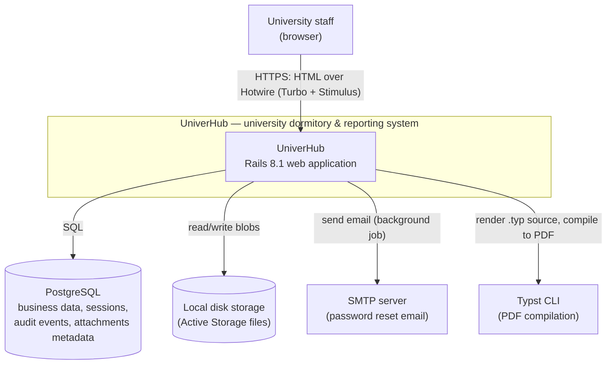

# C4 — Level 1: System Context

UniverHub is a single Rails web application used by university staff to manage student
dormitories (residents, rooms, settlements, payments) and structured report workflows.

## People

| Actor | Description |
|---|---|
| University staff | All users authenticate with email/password. See [roles matrix](roles-matrix.md): global admin/supervisor, dormitory staff (admin, commandant, registrar), reporting staff (admin, manager, reporter, reviewer, visitor) |

There is no public/unauthenticated surface: every page except sign-in and password
reset requires an authenticated, active user.

## External systems

| System | Responsibility | Protocol / notes |
|---|---|---|
| PostgreSQL | Single source of truth: users, roles, sessions, dormitory records, reports, audit events (`outbox_events`) | SQL via ActiveRecord |
| Local disk storage | Active Storage service `:local` — avatars, resident photos, documents, receipt scans, generated PDFs | File system |
| SMTP server | Delivery of password-reset emails | ActionMailer, enqueued as a background job; credentials in Rails credentials |
| Typst CLI | External binary compiled from ERB-rendered `.typ` sources into report PDFs | Process invocation, path in `Rails.configuration.typst_bin_path` |

## Deployment notes

- Single Rails monolith; SSL is terminated by a reverse proxy in production.
- Typst runs as a local subprocess of the application (not a network service).
- Password-reset emails are delivered asynchronously (Active Job); PDF generation runs
  synchronously in-request and results are cached as Active Storage blobs.
