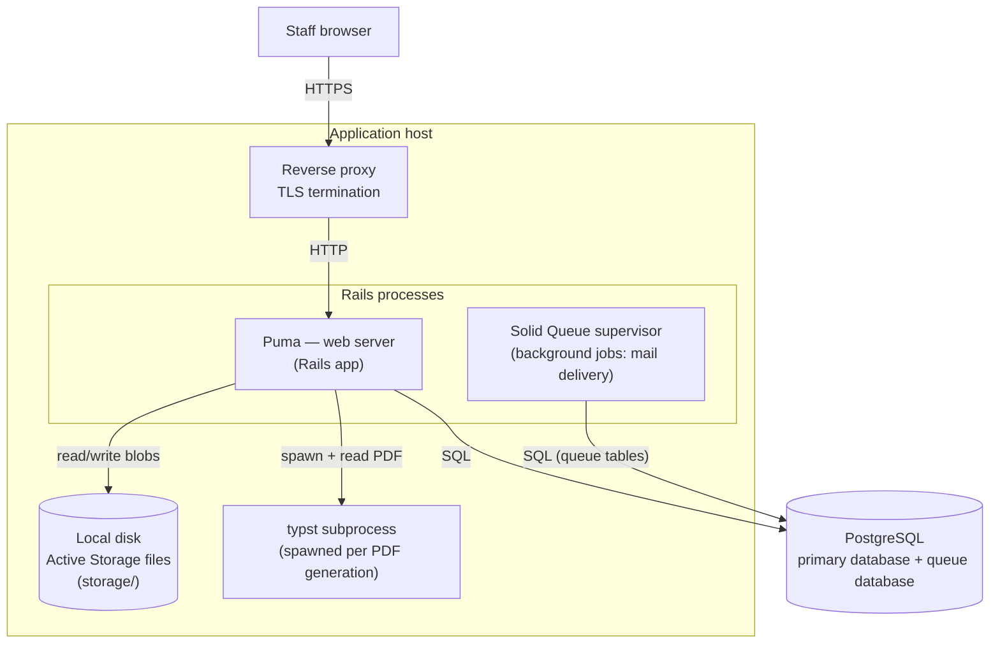

# C4 — Deployment View

Production topology. Single host, classic Rails deployment behind a reverse proxy.

## Notes

- **Processes**: Puma serves HTTP; Solid Queue runs as a separate supervisor process
  from the same codebase (`config.active_job.queue_adapter = :solid_queue`,
  `config.solid_queue.connects_to` → dedicated `queue` database). Currently only
  password-reset mail delivery runs in the background.
- **Database**: one PostgreSQL installation, two logical databases — the primary
  (business data) and the Solid Queue database (jobs).
- **Files**: Active Storage service `:local` — avatars, resident photos, documents,
  receipt scans, cached report PDFs. No CDN/object storage.
- **Typst**: a short-lived subprocess per PDF compilation, path configured in
  `Rails.configuration.typst_bin_path`; not a daemon.
- **TLS**: terminated at the reverse proxy; production is configured for this
  deployment shape (SSL-terminating proxy in front of Puma). Jobs are enqueued by the
  web process through the queue database and picked up by the Solid Queue supervisor.
