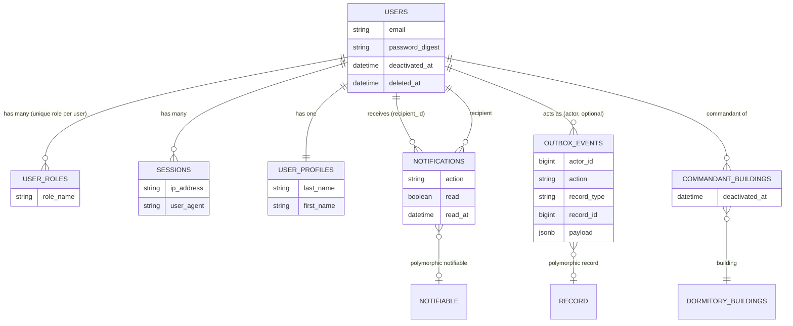
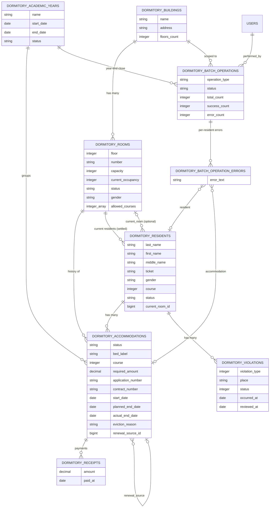
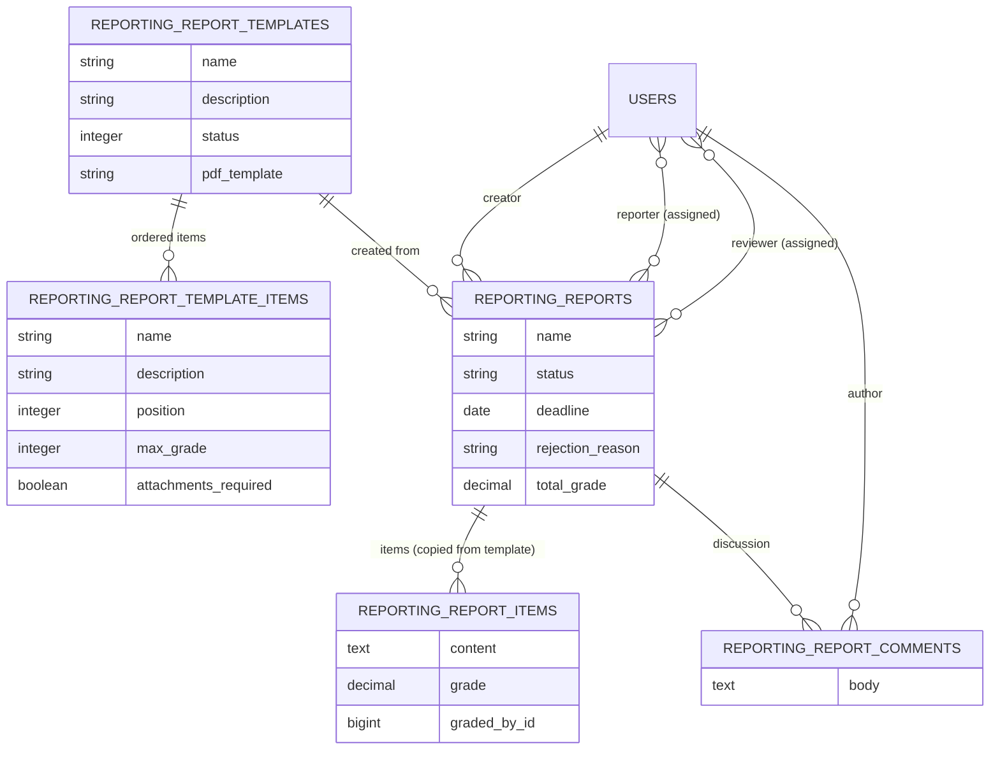

# Domain Model (ERD)

Entity relationships grouped by module. All records use soft delete (`Discard`, column
`discarded_at`); `kept` scopes filter it out everywhere. Key attributes are illustrative,
not exhaustive — see `db/schema.rb` for the full definition.

## Core

`NOTIFIABLE` and `RECORD` are polymorphic targets (any model), shown for completeness.

## Dormitory

Attachments (Active Storage, one per record): resident `photo` + prepared
`application_file`/`contract_file`; accommodation `application_file`/`contract_file`;
receipt `attachment`; violation `protocol_file`.

## Reporting

`REPORTING_REPORTS.pdf_file` is an Active Storage attachment holding the cached
Typst-generated PDF (see [dynamic view](dynamic-view.md)).
