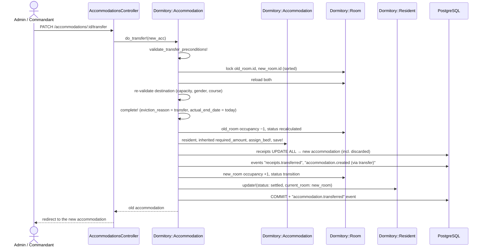
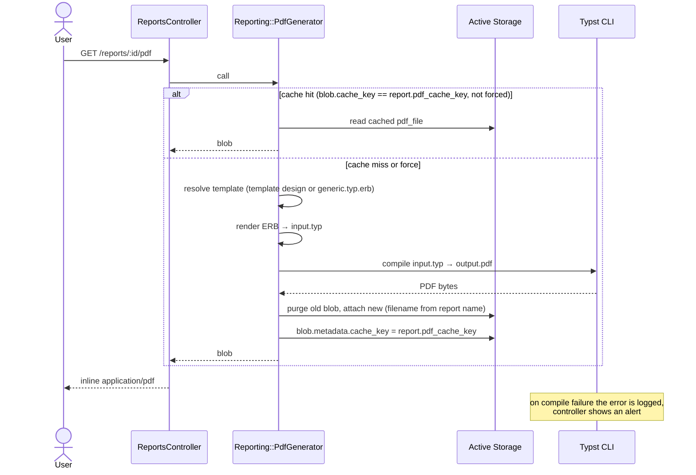

# Dynamic View — Sequence Diagrams

Runtime interactions for the concurrency-critical flows and PDF generation.
The common pattern for settlement operations: **lock → reload → re-validate → mutate**,
so stale reads can never bypass room capacity and gender rules.

## Confirm pending accommodation (`do_confirm!`)

Triggered by an admin or registrar after resident registration reserved a place.

```mermaid
sequenceDiagram
    actor U as Admin / Registrar
    participant RC as AccommodationsController
    participant Acc as Dormitory::Accommodation
    participant Room as Dormitory::Room
    participant Res as Dormitory::Resident
    participant DB as PostgreSQL

    U->>RC: POST /accommodations/:id/confirm
    RC->>Acc: do_confirm!
    Acc->>DB: BEGIN; track_event journal record
    Acc->>Room: with_lock (SELECT … FOR UPDATE)
    Acc->>Res: lock_preserving_attachment_changes!
    Acc->>Acc: reload (fresh state under lock)
    Acc->>Acc: validate_pending! (still pending?)
    alt occupancy > capacity and not force
        Acc-->>RC: RecordInvalid (room full)
        Acc->>DB: ROLLBACK
    else invariants hold
        Acc->>Acc: confirm! (pending → active)
        Acc->>Res: update!(status: settled, current_room: room)
        Acc->>DB: COMMIT + "accommodation.confirmed" event
        Acc-->>RC: accommodation
        RC-->>U: redirect, success notice
    end
```

## Transfer between rooms (`do_transfer!`)

Both rooms are locked **in sorted id order** to avoid deadlocks between concurrent
transfers touching the same pair of rooms.



## PDF generation (`Reporting::PdfGenerator`)

Synchronous, in-request; the compiled PDF is cached as an Active Storage blob and
invalidated by comparing a `cache_key` derived from the report data.



## Related reading

- State transitions: [state-machines.md](state-machines.md)
- Use cases: [use-cases.md](use-cases.md)
