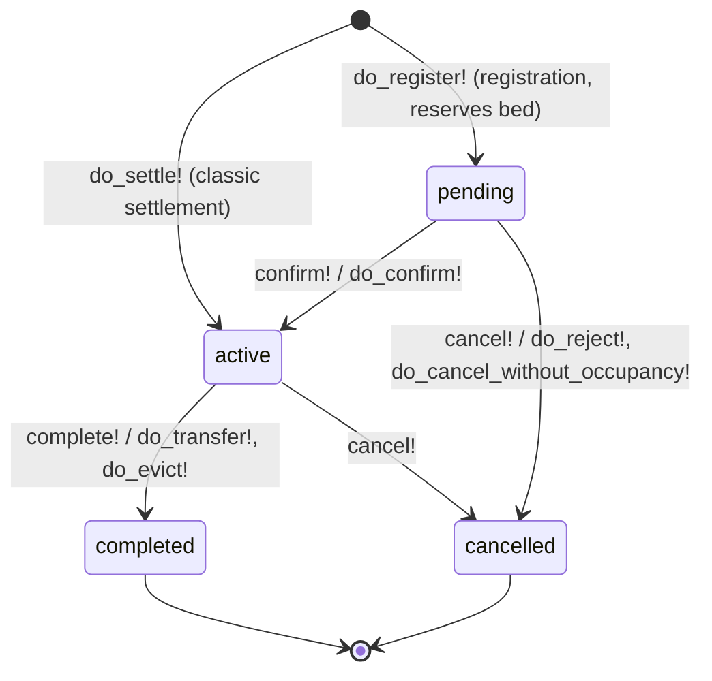
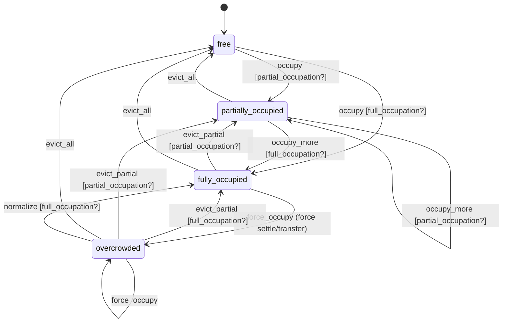
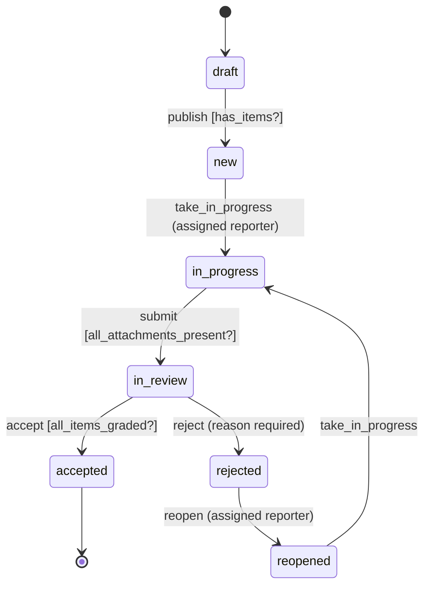
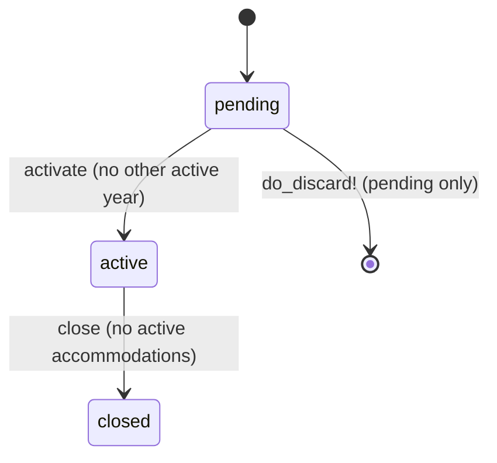
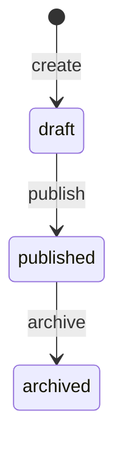
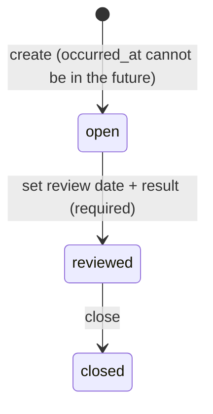

# State Machines

AASM state machines and status lifecycles of key domain records. All transitions are
enforced in code (`app/models`) via explicit `do_*!` event methods; every state change
is journaled to `outbox_events`.

## Accommodation (`Dormitory::Accommodation`)

AASM, column `status`. The machine's initial state is `active` (the classic
`do_settle!` path); `pending` is set explicitly by `do_register!` when a place is
reserved during resident registration.

Notes:
- `do_transfer!` completes the old record with reason `transfer` and creates a new `active` accommodation, moving all receipts to it.
- `do_evict!` completes the record (reason required, `other` requires a comment), sets the resident `evicted`.
- `do_discard!` (soft delete) reconciles first: an `active` record runs the full eviction equivalent, a `pending` record the rejection equivalent.
- `do_update_pending!` keeps the record `pending` but may release the old room and reserve a new one.

## Room occupancy (`Dormitory::Room`)

AASM, column `status`. Guards compare `current_occupancy` with `capacity`:
`partial_occupation?` (0 < occupancy < capacity) and `full_occupation?` (occupancy ≥ capacity).
Transitions are triggered by accommodation operations, never by hand.

## Report (`Reporting::Report`)

AASM, column `status`. Guarded transitions protect the workflow contract;
notifications are sent to the reporter/reviewer on assignment and submission.

## Academic year (`Dormitory::AcademicYear`)

AASM, column `status`. Business invariants: only one `active` year at a time;
`do_close!` is denied while active accommodations reference the year.

## Report template (`Reporting::ReportTemplate`) — status enum, not AASM

## Violation (`Dormitory::Violation`) — status enum, not AASM

## Batch operation status (`Dormitory::BatchOperation`) — plain column

`pending` → `completed` (all residents evicted) or `partial` (some failed; per-resident
errors are stored in `dormitory_batch_operation_errors`).
